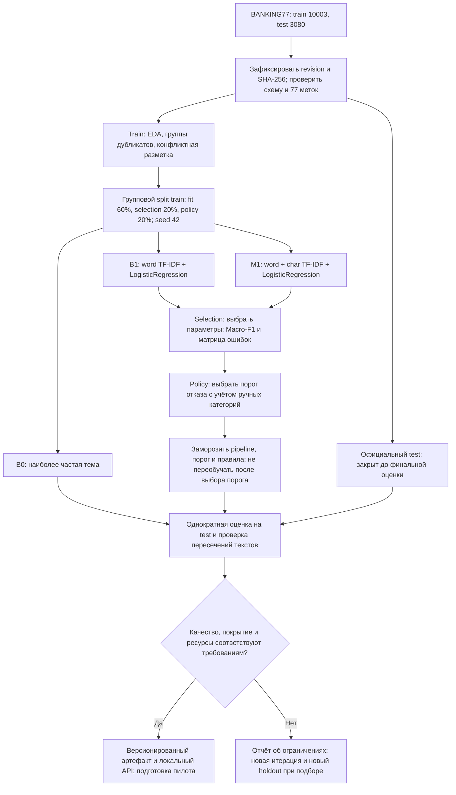
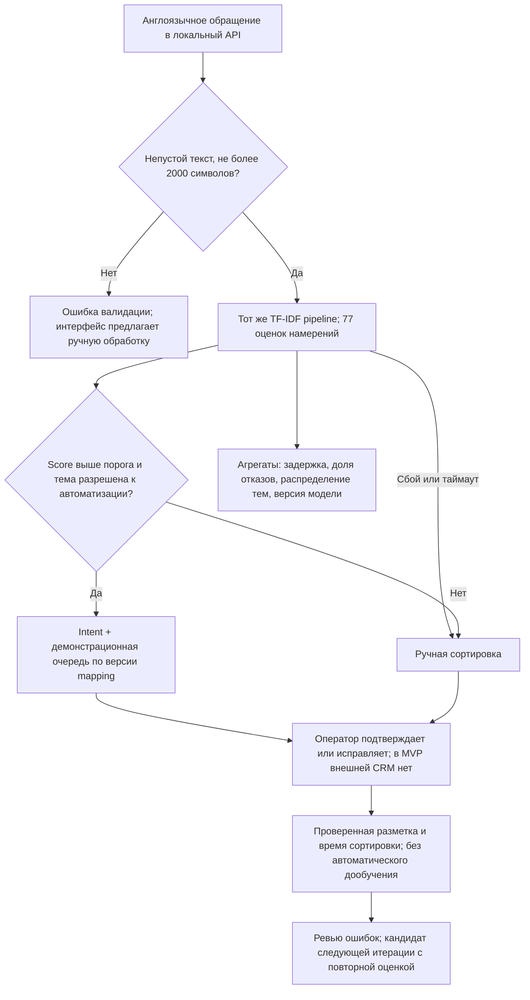

# ML System Design Doc — Support Intent Router

**Продукт:** помощник распределения обращений банковской поддержки.
**Итерация:** MVP, версия документа 1.0.
**Дата:** 29.10.2026. **Статус:** проектирование до EDA и обучения.
**Ответственность:** Product Owner определяет продуктовые требования, Data Scientist
отвечает за данные и качество модели, ML Engineer — за воспроизводимость и инференс.
Требования и правила маршрутизации предварительные и подлежат согласованию
с руководителем поддержки до пилота.

Структура адаптирована из [шаблона Reliable ML][template]. Все численные требования
к продукту ниже — **проектные допущения и критерии приёмки**, а не измеренные результаты.
Сведения о датасете взяты из [репозитория PolyAI][data] и [карточки BANKING77][card].
Разделы после 2.2 описывают план следующих итераций; они не означают, что система реализована.

## Навигация

- [1. Цели и предпосылки](#goals)
- [1.1. Зачем разрабатывать продукт](#why)
- [1.2. Бизнес-требования и ограничения](#requirements)
- [1.3. Scope и результат итерации](#scope)
- [1.4. Предпосылки решения](#assumptions)
- [2.1. Постановка ML-задачи](#ml-task)
- [2.2. Блок-схемы решения](#diagrams)
- [2.3. Данные и этапы разработки](#stages)
- [3. Подготовка и оценка пилота](#pilot)
- [4. Архитектура и эксплуатация](#operations)
- [5. Риски и вопросы заказчику](#risks)
- [6. Дорожная карта](#roadmap)
- [7. Источники](#sources)

## 1. Цели и предпосылки

### 1.1. Зачем разрабатывать продукт

**Контекст.** Целевой процесс — первичная сортировка обращений в поддержку цифрового банка. Входящие
англоязычные сообщения сначала просматривает оператор, определяет тему и направляет
специалисту. Ошибка сортировки вызывает повторную передачу и увеличивает ожидание клиента.
Заинтересованные стороны: руководитель поддержки, операторы, команда качества и клиенты.

**Бизнес-цель:** сократить среднее активное время первичной сортировки минимум на 20%
относительно ручного процесса при контроле ошибочных назначений. Время ожидания в очереди
и время полного решения обращения учитываются отдельно и не подменяют эту метрику.

**Почему ML может помочь.** Одну тему можно выразить множеством формулировок.
Правила по ключевым словам трудно поддерживать на 77 близких темах. Классификатор
учится на примерах, а порог принятия решения позволяет выбирать компромисс между
автоматизацией и ошибками. Превосходство над baseline требуется проверить экспериментом.

**Пользователи продукта.** Оператор видит предложенную тему и может её исправить;
руководитель получает агрегаты ошибок, доли ручной работы и времени сортировки.
Для клиента интерфейс общения с поддержкой на первой итерации не меняется.

**Критерии успеха MVP:** воспроизводимое превосходство над baseline по критериям раздела 2.1,
работающий отказ от автоматического решения и выполнение технических ограничений.
Экономия времени и денег остаётся гипотезой до реального пилота.

### 1.2. Бизнес-требования и ограничения

| ID | Требование | Как проверяем |
| --- | --- | --- |
| БТ-1 | Для одного англоязычного сообщения определить одну из 77 тем | Macro-F1, accuracy и матрица ошибок на test |
| БТ-2 | При достаточном качестве предлагать очередь обработки | Версионируемая таблица `intent → queue`, подтверждённая руководителем поддержки |
| БТ-3 | При низкой уверенности направлять на ручную сортировку | Порог и доля отказов, проверка пограничных запросов |
| БТ-4 | Сохранить возможность исправить тему оператором | Запись исходного и итогового решения в отдельный журнал обратной связи |
| БТ-5 | Сократить время первичной сортировки на 20% без заметного роста переводов | Сравнение с контрольной группой, раздел 3 |
| БТ-6 | При сбое модели сохранить доступ к поддержке | Передача запроса в ручную очередь и тесты отказов |

**Сценарии использования.** Сообщение о доставке карты получает тему `card_arrival`.
Если оценка ниже порога, оператор выбирает тему сам. Сообщение о потерянной карте
не должно ожидать автоматического ответа: система лишь помогает сортировке,
а правила обработки таких обращений утверждает заказчик.

**Ограничения MVP:**

- Один разработчик, 4 недели после принятия дизайна; без платных внешних API и GPU.
- Ориентир среды: CPU, 4 вычислительных ядра, 8 ГБ RAM; лимит памяти процесса 2 ГБ.
  Обучение кандидата должно укладываться в 30 минут; это бюджет, подлежащий замеру.
- Только английский язык и банковский домен. Поддержка русского требует других данных.
- На входе один текст длиной 1–2 000 символов после удаления крайних пробелов.
  Длинный текст не обрезается незаметно: интерфейс предлагает ручную обработку.
- Для разработки используется публичный корпус BANKING77. Данные о времени обработки,
  фактической нагрузке и очередях поддержки необходимо получить до пилота.
- Никаких автоматических ответов, денежных действий, блокировок карты или оценки клиента.
- Интеграция с CRM выполняется после проверки локального MVP и согласования контрактов.

**Ожидаемый результат:** MVP системы, которая определяет тему обращения и предлагает
соответствующую очередь поддержки. При низкой уверенности модели или техническом сбое
обращение передаётся на ручную сортировку. Оператор может подтвердить или исправить
предложенную тему.

В рамках MVP будут проверены качество классификации, точность автоматической
маршрутизации и доля обращений, обрабатываемых без ручной сортировки. БТ-1, БТ-3
и БТ-6 проверяются на локальном сервисе; БТ-2 и БТ-4 — на демонстрационных очередях.
Снижение времени сортировки минимум на 20% (БТ-5) — целевой бизнес-результат,
который необходимо подтвердить в пилоте на реальном потоке обращений.

### 1.3. Что входит в scope

| Область | В MVP | За пределами MVP |
| --- | --- | --- |
| Данные | BANKING77, проверки качества, фиксированные split и seed | Закрытые банковские логи, сбор персональных данных |
| ML | Одно намерение на текст, baseline и один улучшенный кандидат | Диалоговый контекст, multi-label, LLM-агент, перевод |
| Решения | Тема, score, ручной отказ, демонстрационная очередь | Реальные назначения в CRM и банковские операции |
| Интерфейс | Локальный HTTP API и примеры запросов | Полноценный кабинет оператора и клиентский чат |
| Оценка | Offline-метрики, порог, ошибки, время и память | Заявление о доказанном снижении затрат банка |
| Эксплуатация | Версия артефакта, healthcheck, fallback, агрегатные логи | Kubernetes, распределённые очереди и круглосуточная поддержка |

**Воспроизводимость:** фиксируем checksum данных, split-манифесты, seed `42`, версии
зависимостей, код, параметры и артефакт модели. TF-IDF и классификатор хранятся в едином
pipeline, чтобы обучение и инференс использовали одинаковые преобразования.
Требуется воспроизводимость метрик в согласованном окружении; побитовая идентичность
моделей между разными ОС и версиями библиотек не обещается.

**Плановый технический долг:** нет настоящей CRM, организационной схемы очередей,
потока разметки, репрезентативного OOD-набора и production-мониторинга.
Перед внедрением нужны данные заказчика, нагрузочные замеры, управление доступом,
правила хранения, проверка отказов и процедура отката. Эти компоненты необходимо
подготовить до подключения внешних пользователей и банковских процессов.

### 1.4. Предпосылки решения

| Предпосылка | Обоснование и следствие |
| --- | --- |
| Один текст имеет одну основную тему | Соответствует разметке BANKING77; несколько вопросов в одном тексте — отдельный риск |
| Тема зависит от доступного текста | В BANKING77 нет профиля клиента; дополнительные персональные признаки не нужны |
| 77 тем достаточно для демонстрации | Это пространство меток датасета, а не подтверждённая таксономия банка |
| Тему можно сопоставить очереди | В MVP очередь имеет ID темы; реальную группировку необходимо получить от заказчика |
| Ошибка назначения дороже ручной проверки | Поэтому вводим отказ и оцениваем точность на автоматически принятых решениях |
| Распределение данных относительно стабильно | Иначе offline-оценка не переносится; перед пилотом требуется проверка на свежих данных |
| CPU достаточно для линейной модели | Проверяем на ограничениях памяти и задержки до интеграции |

Гранулярность: одно обращение, один прогноз при поступлении сообщения. Горизонта
прогнозирования будущего нет. При смене текста выполняется новый прогноз.
Переобучение не требуется на каждый запрос; оно проводится после накопления проверенной
разметки или заметного ухудшения качества с полной повторной валидацией.

## 2. Методология

### 2.1. Постановка ML-задачи

Это многоклассовая классификация намерения: `x` — текст на английском,
`y ∈ C`, где `C` — 77 исходных категорий BANKING77.
Для сообщения вычисляем вектор оценок `p(c | x)`, выбираем `c* = argmax p(c | x)`
и `s = max p(c | x)`. Значение `s` называется score; без проверки калибровки
его нельзя интерпретировать как достоверную вероятность правильного решения.

Политика MVP: если `s ≥ τ` и категория разрешена к автоматизации, предлагаем маршрут;
иначе `needs_review = true`, очередь — ручная сортировка. При ошибке сервиса действует
тот же ручной fallback. Оператору можно показывать три наиболее вероятные темы,
но основная оценка проводится по первой.

В консервативной демонстрационной политике категории `lost_or_stolen_card`,
`compromised_card` и `card_payment_not_recognised` всегда требуют оператора.
Это неполный пример правил, а не гарантия обнаружения всех опасных обращений:
модель может ошибочно предсказать другую тему. До реального запуска перечень и
дополнительные правила должен утвердить руководитель поддержки.

**Сравниваемые решения:**

| Решение | Признаки и алгоритм | Для чего нужно |
| --- | --- | --- |
| B0, sanity check | `DummyClassifier(strategy="most_frequent")` | Проверить расчёт метрик и сравнить с тривиальным решением |
| B1, основной baseline | TF-IDF слов, n-gram 1–2; `LogisticRegression`, `C=1`, `max_iter=2000` | Простой CPU-вариант, опорная точка для сравнения |
| M1, кандидат MVP | Объединение word TF-IDF 1–2 и char TF-IDF 3–5; логистическая регрессия | Проверить пользу устойчивости к опечаткам и вариативности написания |

У M1 ограничиваем словарь: до 30 000 словесных и 50 000 символьных признаков,
разреженные матрицы `float32`; `C ∈ {0.5, 1, 2}` выбирается на model-selection split.
Оба содержательных решения используют одинаковые данные и правила ручного отказа.
Сложный кандидат не внедряется автоматически: если выигрыша нет, сохраняем B1.

**Метрики и критерии допуска:**

| Метрика | Определение и смысл | Цель |
| --- | --- | --- |
| Macro-F1 | Среднее F1 по всем 77 классам на всех валидных in-domain текстах, до отказа | B1 ≥ 0,80; M1 ≥ 0,85 и прирост к B1 ≥ 0,02 абсолютного значения |
| Accuracy, per-class precision/recall | Доля правильных top-1 и качество отдельных тем | Отчёт без скрытия слабых классов |
| Точность принятых решений, P | `число верных автоматически принятых / число автоматически принятых` | ≥ 0,95 |
| Покрытие, C | `число автоматически принятых / все валидные in-domain сообщения` | ≥ 0,50 одновременно с P ≥ 0,95 |
| Top-3 accuracy | Есть ли верная тема среди трёх подсказок | Диагностика помощи оператору, без отдельного порога |
| p95 задержки | 95-й перцентиль времени HTTP-обработки без внешней сети, после прогрева | ≤ 200 мс при 5 запросах/с на заявленной CPU-среде |

P — accuracy на выбранном подмножестве; это не macro-precision по классам.
При нуле принятых решений P не определена, такой вариант не проходит критерий покрытия.
Порог `τ` выбираем на отдельном policy-validation split: максимизируем C при P ≥ 0,95.
Публикуем объём принятой выборки, число ошибок и 95% интервал Уилсона для P:
точечная оценка на небольшой выборке не доказывает надёжность.
Для Macro-F1 и разницы моделей используем парный bootstrap на одинаковых объектах test.

Все целевые значения предварительные. При невыполнении условий не объявляем успех:
анализируем ошибки на development-данных, пересматриваем гипотезу и фиксируем новую итерацию.
Если M1 не улучшает B1, но B1 выполняет самостоятельные критерии качества и покрытия,
к пилоту можно предложить B1 с явным объяснением выбора более простой модели.

**Связь с бизнесом.** C определяет объём снятой ручной работы, P — риск повторной
маршрутизации. Для иллюстрации, при ручной сортировке `t=30 с`, цене исправления
`r=100 с`, `C=0,5` и `P=0,95` получаем `t·(1−C)+r·C·(1−P)=17,5 с` на обращение.
Это условная модель затрат без накладных расходов, а не прогноз эффекта.
Реальные `t`, `r`, время подтверждения оператором и тяжесть ошибок измеряются в пилоте.

### 2.2. Блок-схемы решения

Схемы описывают целевую архитектуру MVP: обучение, выбор модели, обработку обращений
и сбор обратной связи. Реализация компонентов запланирована на следующие этапы.

**Обучение, baseline и кандидат MVP:**

**Обработка одного обращения и обратная связь:**

### 2.3. Данные и этапы разработки

#### Этап 1. Подготовка и проверка данных

**Известно из источника:** BANKING77 содержит 10 003 train и 3 080 test примеров,
77 категорий английских банковских запросов; лицензия CC BY 4.0.
Названия категорий берём из версии источника, не сортируем с потерей исходного mapping.
Оригинальные CSV имеют текст и категорию; в Hugging Face категория представлена
целочисленной меткой с именами классов. Адаптер должен явно привести их к общей схеме.

**Целевая переменная:**

| Поле | Источник | Получение | Качество проверено? |
| --- | --- | --- | --- |
| `intent` | Метка BANKING77 | DS: загрузить файлы и 77 имён категорий | Нет; проверены только сведения в описании |

**Признаки и служебные поля:**

| Поле | Источник | Использование | Качество проверено? |
| --- | --- | --- | --- |
| `text` | Текст BANKING77 | Единственный вход модели | Нет, EDA запланирован |
| `sample_id` | ID из имени split и номера исходной строки | Аудит разбиения; не признак | Создаётся при подготовке |
| `text_group` | SHA-256 нормализованного текста | Группировка дубликатов; не признак | Проверяется при подготовке |
| `intent_to_queue` | Начальный mapping `intent → intent` | Демонстрация маршрута; не обучающая метка | Реальные очереди отсутствуют |

В наборе нет надёжных идентификаторов клиентов и временных меток обращений.
Поэтому нельзя обещать разбиение по клиентам или временную валидацию. Случайное
разбиение оценивает перенос внутри этого корпуса, а не на будущий поток банка.

**План EDA и разбиения:**

1. Сохранить исходные файлы без изменения, revision, лицензию, checksum и число строк.
2. На train проверить пустые тексты, длины, дисбаланс классов, неизвестные метки,
   дубликаты и близкие формулировки. Для exact-групп использовать lowercase,
   нормализацию Unicode и свёртку пробелов; исходный текст сохранить.
3. Точные дубликаты с одной меткой свести к одной записи. Конфликтные метки
   исключить из development-выборки и перечислить в отчёте для ручного разбора.
   Близкие дубликаты проверить отдельно; метод и порог группировки зафиксировать до split.
4. Разделить исходный train примерно на 60% fit, 20% model-selection и 20% policy-validation
   с сохранением групп дубликатов и максимально близкого распределения 77 классов.
   Сохранить IDs и проверить наличие каждого класса во всех частях.
   Если это невозможно, остановиться и пересмотреть схему, а не смешивать группы.
5. Обучать словари и классификаторы только на fit. На selection выбирать признаки и `C`.
   На policy выбирать только порог принятия. После этого pipeline не переобучать:
   иначе распределение score меняется и выбранный порог требует новой проверки.
6. Официальный test использовать один раз после фиксации решений. Тогда же проверить
   пересечения текстов с development-частью и дополнительно показать метрики на test
   без пересечений. Основной вывод о переносе делать по очищенной части; benchmark-результат
   на полном test публиковать отдельно с числом пересечений. Метки test не участвуют в подборе.

Итог этапа: отчёт EDA, исходные файлы и checksum, витрина `sample_id/text/intent`,
split-манифесты и список обнаруженных ограничений. Объёмы после очистки пока неизвестны.

#### Этап 2. Baseline

Посчитать B0, обучить B1, сохранить параметры и train/selection-метрики.
Не удалять отрицания и не выполнять агрессивный стемминг без эксперимента:
это может сблизить разные намерения. Просмотреть ошибки близких категорий,
например `card_arrival` и `card_delivery_estimate`, с проверкой на selection.
Зафиксировать seed, версии, время обучения и память. Выход — опорный результат B1.

#### Этап 3. MVP и политика отказа

Сравнить M1 и B1 на одинаковых split, измерить цену дополнительных символьных
признаков по памяти и задержке. Выбрать модель на selection, затем подобрать `τ`
на policy и записать coverage/точность для сетки порогов. Без калибровки используем
score только как ранжирующий сигнал для эмпирически проверенной политики.
Если ограничения не достигаются, сохранить отрицательный результат.

#### Этап 4. Финальная проверка и артефакты

Оценить замороженные B1 и выбранный M1 с их политиками на одном test; сохранить
Macro-F1, accuracy, per-class показатели, coverage, P, интервалы и матрицы ошибок.
Не выбирать победителя повторным подбором по test. Если test повлиял на новые
решения, для их финальной проверки нужен новый отложенный набор.
Сохранить pipeline, `categories.json`, `policy.json`, `intent_to_queue.json`,
метаданные данных и model card с ограничениями.

#### Этап 5. Локальный инференс и подготовка пилота

Загрузить модель один раз при старте API, реализовать валидацию и ручной fallback.
Проверить неизвестный текст, опечатки, несколько вопросов, длинный ввод и сбой загрузки.
Отдельный небольшой набор вне домена используется только как проверка ограничений:
у BANKING77 нет полноценной OOD-разметки, поэтому надёжное выявление новых намерений
по нему не заявляется. Результат этапа — демонстрация и отчёт о готовности к пилоту.

## 3. Подготовка и оценка пилота

### 3.1. Процесс и дизайн оценки

До подключения к поддержке планируется offline replay с моделью и демонстрационными
очередями. Этот этап позволит проверить классификацию и маршруты. Для измерения
экономии времени операторов потребуется пилот в рабочем процессе поддержки.

Для реального пилота сначала 1–2 недели теневого режима: прогнозы не изменяют маршрут,
эксперты независимо проверяют случайную выборку всех решений, включая ручные отказы.
Отбор только исправленных оператором ошибок недопустим из-за смещения обратной связи.
После приёмки данных и правил — контролируемый эксперимент: контроль сортирует вручную,
эксперимент использует подсказки и разрешённые автоматические назначения.
Разделение по клиенту, если его ID доступен у заказчика, сохраняет обращения одного клиента
в одной группе; анализ учитывает зависимость наблюдений одного клиента и оператора.

До запуска фиксируем расчёт активного времени сортировки, причины переводов,
состав категорий, длительность и правила остановки. Размер выборки рассчитываем
по дисперсии времени, исходной частоте ошибок и ожидаемому эффекту; 1–2 недели
теневого режима не гарантируют достаточную статистическую мощность.

### 3.2. Критерии успешного пилота

- Среднее активное время сортировки на всех обращениях экспериментальной группы
  ниже контроля минимум на 20%; сообщаем доверительный интервал эффекта.
- Доля ошибочных первых назначений на всех обращениях не растёт более чем на
  1 процентный пункт относительно контроля; верхняя граница 95% интервала разницы
  должна укладываться в этот предел. Причину каждого перевода проверяет эксперт.
- Для автоматических назначений P ≥ 0,95, покрытие ≥ 0,50, с интервалами и срезами по темам.
- В критических сценариях нет ухудшения согласованных с заказчиком guardrail-метрик;
  их перечень и допустимые пределы нужно утвердить до эксперимента.
- При росте ошибок, критическом инциденте или недоступности сервиса автоматизация
  выключается; все обращения возвращаются на ручной процесс.

Показатели по времени и ошибкам считаются для всех запросов, включая отказы модели,
чтобы нельзя было улучшить отчёт выбором только лёгких обращений.

### 3.3. Ресурсы

Вычислительный бюджет MVP — один локальный CPU-компьютер, без облачных расходов.
До пилота измеряем время обучения, размер артефакта, память и p95 на целевом железе.
Ресурсы операторов, интеграции и разметки пока не оценены: для расчёта нужны
реальный объём обращений, стоимость часа и доля ошибок исходного процесса.

## 4. Архитектура и эксплуатация будущего MVP

### 4.1. Компоненты и интерфейс

Один локальный процесс FastAPI с pipeline в памяти, версионируемые файлы модели и
конфигурации; обучение отдельной командой. База данных и брокер в MVP не требуются.
Методы ниже — проект контракта, сейчас они не реализованы.

- `POST /predict`: `{"text": "When will my card arrive?"}`.
- Ответ: `intent`, `score`, `needs_review`, `queue_id`, `model_version`, `policy_version`.
  При отказе прогноз можно сохранить как подсказку, но `queue_id` указывает ручную очередь.
- `GET /health`: процесс отвечает; `GET /ready`: модель и конфигурации успешно загружены.
- Невалидный ввод — HTTP 422; отсутствие модели — 503. Будущий клиент API должен
  интерпретировать таймаут/503 как переход на ручной процесс, а не потерю обращения.

Mapping очередей и политика отказа версионируются отдельно от классификатора.
Результат назначения воспроизводится по тройке версий модели, политики и mapping.

### 4.2. Нагрузка, надёжность и масштабирование

Проектное допущение — 10 000 сообщений в сутки (около 0,116 запроса/с в среднем),
проверяемая постоянная нагрузка 5 запросов/с и всплеск 20 запросов/с в течение минуты.
Для постоянной нагрузки целимся в p95 ≤ 200 мс и долю серверных ошибок < 1%.
На всплеске проверяем отсутствие потерь и ограниченность ресурсов; при перегрузке
разрешены отказ и ручная обработка. Это ещё не результат нагрузочного теста.

При лимите 2 000 символов UTF-8 текст занимает до примерно 8 КБ;
10 000 запросов — до 80 МБ текстового входа в сутки без HTTP-накладных расходов.
Сырые тексты в технических логах не храним. Агрегатные метрики и метаданные
планируем ограничить 1 КБ на запрос, то есть примерно 10 МБ в сутки до ротации.

Production SLA на этапе локального MVP не обещается. Для будущего пилота предварительный
ориентир доступности модельного сервиса — 99% рабочего времени и восстановление до
30 минут; обслуживание клиентов продолжает работать вручную при его недоступности.
Значения согласуются с поддержкой до подключения реального потока.

Узкие места: размер символьного словаря, память нескольких worker и CPU на длинных
текстах. Сначала ограничиваем словарь и длину, измеряем один процесс; при необходимости
добавляем процессы с учётом копий модели в RAM, затем реплики за балансировщиком.
Решение о переходе к распределённой инфраструктуре принимается по результатам замеров.

### 4.3. Мониторинг и обновление модели

Собираем количество запросов, p50/p95, HTTP-ошибки, долю ручных отказов, длины текстов
и распределение предсказанных тем. Качество измеряем по независимо проверенной разметке,
а не по распределению score. Изменение тем или доли отказов — повод для анализа,
но само по себе не доказывает ухудшение модели.

Еженедельно просматриваем агрегаты и ошибки. Переобучение — вручную после накопления
репрезентативной разметки; автоматического обучения на неподтверждённых исправлениях нет.
Новый артефакт проходит offline-проверки и теневой режим. Сервис заменяет связанный набор
модели, категорий и политик атомарно; предыдущая версия сохраняется для отката.

### 4.4. Безопасность и затраты

Локальная демонстрация слушает только localhost. Для настоящего пилота нужны
аутентификация интеграции, ограничение доступа, TLS и правила обработки персональных данных.
До этого реальные обращения использовать нельзя. Текст пользователя считается данными;
никакие содержащиеся в нём команды не исполняются.

Не логируем исходные тексты и банковские реквизиты; для анализа ошибок нужен отдельный
обезличенный набор с разрешённым доступом и согласованным сроком хранения.
Данные BANKING77 сопровождаем ссылкой на источник, авторов и CC BY 4.0.
Если модель сохраняется через pickle/joblib, загружаем только собственный проверенный
артефакт: чужой файл в таком формате может выполнять код при десериализации.

Дополнительные денежные затраты локальной демонстрации принимаем равными нулю
при наличии компьютера; трудозатраты и электроэнергия сюда не включены.
Стоимость реального внедрения не рассчитана. Формула оценки: вычисления и хранение +
разметка + интеграция + поддержка; экономия — снятые часы сортировки минус цена ошибок.

## 5. Риски и вопросы заказчику

| Риск | Последствие | Действие |
| --- | --- | --- |
| Близкие намерения BANKING77 | Ошибочные переводы между очередями | Матрица ошибок, разбор пар классов, порог и ручная проверка |
| Новая тема или иной язык | Высокая уверенность при неверном ответе | Проверка на отдельном наборе, запрет заявлять полноценное OOD-распознавание |
| Дубликаты в разных split | Завышенное качество | Группировка на train и отдельная оценка пересечений test |
| Отличие реального потока от корпуса | Offline-метрики не воспроизводятся | Свежая разметка и теневой пилот до автоматизации |
| Нет реального intent-to-queue mapping | Категория BANKING77 может не соответствовать очереди поддержки | Согласовать справочник с руководителем поддержки |
| Ошибка в критичном обращении | Задержка помощи клиенту | Консервативные правила, аудит, ручной процесс и остановка пилота |
| Отзывы только по ошибкам | Смещённая оценка качества | Независимый случайный аудит всех видов решений |
| M1 не лучше B1 | Лишняя сложность и расход памяти | Оставить B1; задокументировать отрицательный эксперимент |

**Открытые вопросы (требуют согласования до реального пилота):**

1. Какие реальные очереди, языки, пики нагрузки и классы обращений нужны?
2. Как измерять первичную сортировку и отличать её ошибку от дальнейшего перевода?
3. Какие темы всегда требуют человека, и каковы последствия пропуска каждой?
4. Каковы допустимая цена ошибки, целевое покрытие и текущий ручной baseline?
5. Кто размечает свежие обращения и подтверждает итоговую тему независимо от модели?
6. Какие сроки хранения, доступ и правила обезличивания согласованы?

Перечисленные вопросы необходимо закрыть с руководителем поддержки до пилота.
До этого требования и допущения сохраняют предварительный статус.

## 6. Дорожная карта

| Этап | План | Результат и условие перехода |
| --- | --- | --- |
| Проектирование | До начала реализации | Определены цели, требования, архитектура, критерии качества и план оценки |
| Неделя 1 | Данные и EDA | Зафиксированы источник, checksum, split и качество меток; нет скрытого пересечения групп |
| Неделя 2 | B0 и B1 | Воспроизводимые метрики baseline и анализ ошибок, замеры ресурсов |
| Неделя 3 | M1 и отказ | Выбран pipeline, порог и политика; test оценён после заморозки |
| Неделя 4 | API и демонстрация | Проверены валидация, fallback, нагрузка и версии; подготовлен отчёт |
| Подготовка к пилоту | После проверки MVP | Согласование очередей и критических правил, разметка, теневой пилот, затем эксперимент |

Сроки предварительные и уточняются по результатам EDA, замеров ресурсов и согласования
интеграции. Переход между этапами определяется выполнением критериев приёмки.

## 7. Источники

1. [Reliable ML — шаблон ML System Design Doc][template] — структура документа.
2. [PolyAI — task-specific-datasets, BANKING77][data] — состав, размеры, категории и лицензия.
3. [PolyAI/banking77 на Hugging Face][card] — описание полей и языка.
4. [Casanueva et al., Efficient Intent Detection with Dual Sentence Encoders, 2020][paper].
5. [BANKING77 categories.json][categories] — исходные названия намерений.

Дата проверки веб-источников: 29.10.2026. Бизнес-требования, архитектура,
пороги качества и план экспериментов относятся к текущей версии проекта
и уточняются по результатам исследований и согласования пилота.

[template]: https://github.com/IrinaGoloshchapova/ml_system_design_doc_ru/blob/main/ML_System_Design_Doc_Template.md
[data]: https://github.com/PolyAI-LDN/task-specific-datasets
[card]: https://huggingface.co/datasets/PolyAI/banking77
[paper]: https://arxiv.org/abs/2003.04807
[categories]: https://github.com/PolyAI-LDN/task-specific-datasets/blob/master/banking_data/categories.json
