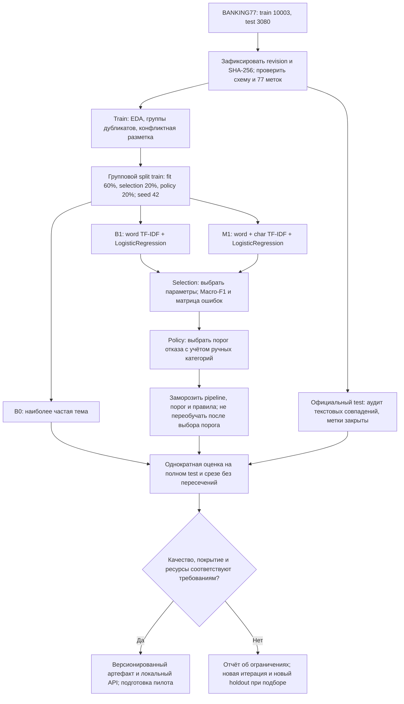
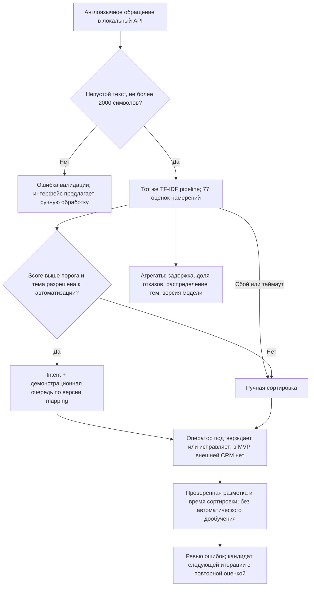

# ML System Design Doc — Support Intent Router

**Продукт:** помощник распределения обращений банковской поддержки.
**Итерация:** MVP, версия документа 1.1.
**Дата:** 14.11.2026. **Статус:** EDA завершён, обучение и пилот запланированы.
**Ответственность:** Product Owner определяет продуктовые требования, Data Scientist
отвечает за данные и качество модели, ML Engineer — за воспроизводимость и инференс.
Требования и правила маршрутизации предварительные и подлежат согласованию
с руководителем поддержки до пилота.

Структура адаптирована из [шаблона Reliable ML][template]. Все численные требования
к продукту ниже — **проектные допущения и критерии приёмки**, а не измеренные результаты.
Сведения о датасете взяты из [репозитория PolyAI][data] и [карточки BANKING77][card].
В §2.3 приведены измеренные результаты EDA и план разработки модели.

## Навигация

- [1. Цели и предпосылки](#goals)
- [1.1. Зачем разрабатывать продукт](#why)
- [1.2. Бизнес-требования и ограничения](#requirements)
- [1.3. Scope и результат итерации](#scope)
- [1.4. Предпосылки решения](#assumptions)
- [2.1. Постановка ML-задачи](#ml-task)
- [2.2. Блок-схемы решения](#diagrams)
- [2.3. Этапы решения задачи](#stages)
- [3. Подготовка и оценка пилота](#pilot)
- [4. Архитектура и эксплуатация](#operations)
- [5. Риски и вопросы заказчику](#risks)
- [6. Дорожная карта](#roadmap)
- [7. Источники](#sources)

## 1. Цели и предпосылки

### 1.1. Зачем разрабатывать продукт

**Контекст.** Целевой процесс — первичная сортировка обращений в поддержку цифрового банка. Входящие
англоязычные сообщения сначала просматривает оператор, определяет тему и направляет
специалисту. Ошибка сортировки вызывает повторную передачу и увеличивает ожидание клиента.
Заинтересованные стороны: руководитель поддержки, операторы, команда качества и клиенты.

**Бизнес-цель:** сократить среднее активное время первичной сортировки минимум на 20%
относительно ручного процесса при контроле ошибочных назначений. Время ожидания в очереди
и время полного решения обращения учитываются отдельно и не подменяют эту метрику.

**Почему ML может помочь.** Одну тему можно выразить множеством формулировок.
Правила по ключевым словам трудно поддерживать на 77 близких темах. Классификатор
учится на примерах, а порог принятия решения позволяет выбирать компромисс между
автоматизацией и ошибками. Превосходство над baseline требуется проверить экспериментом.

**Пользователи продукта.** Оператор видит предложенную тему и может её исправить;
руководитель получает агрегаты ошибок, доли ручной работы и времени сортировки.
Для клиента интерфейс общения с поддержкой на первой итерации не меняется.

**Критерии успеха MVP:** воспроизводимое превосходство над baseline по критериям раздела 2.1,
работающий отказ от автоматического решения и выполнение технических ограничений.
Экономия времени и денег остаётся гипотезой до реального пилота.

### 1.2. Бизнес-требования и ограничения

| ID | Требование | Как проверяем |
| --- | --- | --- |
| БТ-1 | Для одного англоязычного сообщения определить одну из 77 тем | Macro-F1, accuracy и матрица ошибок на test |
| БТ-2 | При достаточном качестве предлагать очередь обработки | Версионируемая таблица `intent → queue`, подтверждённая руководителем поддержки |
| БТ-3 | При низкой уверенности направлять на ручную сортировку | Порог и доля отказов, проверка пограничных запросов |
| БТ-4 | Сохранить возможность исправить тему оператором | Запись исходного и итогового решения в отдельный журнал обратной связи |
| БТ-5 | Сократить время первичной сортировки на 20% без заметного роста переводов | Сравнение с контрольной группой, раздел 3 |
| БТ-6 | При сбое модели сохранить доступ к поддержке | Передача запроса в ручную очередь и тесты отказов |

**Сценарии использования.** Сообщение о доставке карты получает тему `card_arrival`.
Если оценка ниже порога, оператор выбирает тему сам. Сообщение о потерянной карте
не должно ожидать автоматического ответа: система лишь помогает сортировке,
а правила обработки таких обращений утверждает заказчик.

**Ограничения MVP:**

- Один разработчик, 4 недели после принятия дизайна; без платных внешних API и GPU.
- Ориентир среды: CPU, 4 вычислительных ядра, 8 ГБ RAM; лимит памяти процесса 2 ГБ.
  Обучение кандидата должно укладываться в 30 минут; это бюджет, подлежащий замеру.
- Только английский язык и банковский домен. Поддержка русского требует других данных.
- На входе один текст длиной 1–2 000 символов после удаления крайних пробелов.
  Длинный текст не обрезается незаметно: интерфейс предлагает ручную обработку.
- Для разработки используется публичный корпус BANKING77. Данные о времени обработки,
  фактической нагрузке и очередях поддержки необходимо получить до пилота.
- Никаких автоматических ответов, денежных действий, блокировок карты или оценки клиента.
- Интеграция с CRM выполняется после проверки локального MVP и согласования контрактов.

**Ожидаемый результат:** MVP системы, которая определяет тему обращения и предлагает
соответствующую очередь поддержки. При низкой уверенности модели или техническом сбое
обращение передаётся на ручную сортировку. Оператор может подтвердить или исправить
предложенную тему.

В рамках MVP будут проверены качество классификации, точность автоматической
маршрутизации и доля обращений, обрабатываемых без ручной сортировки. БТ-1, БТ-3
и БТ-6 проверяются на локальном сервисе; БТ-2 и БТ-4 — на демонстрационных очередях.
Снижение времени сортировки минимум на 20% (БТ-5) — целевой бизнес-результат,
который необходимо подтвердить в пилоте на реальном потоке обращений.

### 1.3. Что входит в scope

| Область | В MVP | За пределами MVP |
| --- | --- | --- |
| Данные | BANKING77, проверки качества, фиксированные split и seed | Закрытые банковские логи, сбор персональных данных |
| ML | Одно намерение на текст, baseline и один улучшенный кандидат | Диалоговый контекст, multi-label, LLM-агент, перевод |
| Решения | Тема, score, ручной отказ, демонстрационная очередь | Реальные назначения в CRM и банковские операции |
| Интерфейс | Локальный HTTP API и примеры запросов | Полноценный кабинет оператора и клиентский чат |
| Оценка | Offline-метрики, порог, ошибки, время и память | Заявление о доказанном снижении затрат банка |
| Эксплуатация | Версия артефакта, healthcheck, fallback, агрегатные логи | Kubernetes, распределённые очереди и круглосуточная поддержка |

**Воспроизводимость:** фиксируем checksum данных, split-манифесты, seed `42`, версии
зависимостей, код, параметры и артефакт модели. TF-IDF и классификатор хранятся в едином
pipeline, чтобы обучение и инференс использовали одинаковые преобразования.
Требуется воспроизводимость метрик в согласованном окружении; побитовая идентичность
моделей между разными ОС и версиями библиотек не обещается.

**Плановый технический долг:** нет настоящей CRM, организационной схемы очередей,
потока разметки, репрезентативного OOD-набора и production-мониторинга.
Перед внедрением нужны данные заказчика, нагрузочные замеры, управление доступом,
правила хранения, проверка отказов и процедура отката. Эти компоненты необходимо
подготовить до подключения внешних пользователей и банковских процессов.

### 1.4. Предпосылки решения

| Предпосылка | Обоснование и следствие |
| --- | --- |
| Один текст имеет одну основную тему | Соответствует разметке BANKING77; несколько вопросов в одном тексте — отдельный риск |
| Тема зависит от доступного текста | В BANKING77 нет профиля клиента; дополнительные персональные признаки не нужны |
| 77 тем достаточно для демонстрации | Это пространство меток датасета, а не подтверждённая таксономия банка |
| Тему можно сопоставить очереди | В MVP очередь имеет ID темы; реальную группировку необходимо получить от заказчика |
| Ошибка назначения дороже ручной проверки | Поэтому вводим отказ и оцениваем точность на автоматически принятых решениях |
| Распределение данных относительно стабильно | Иначе offline-оценка не переносится; перед пилотом требуется проверка на свежих данных |
| CPU достаточно для линейной модели | Проверяем на ограничениях памяти и задержки до интеграции |

Гранулярность: одно обращение, один прогноз при поступлении сообщения. Горизонта
прогнозирования будущего нет. При смене текста выполняется новый прогноз.
Переобучение не требуется на каждый запрос; оно проводится после накопления проверенной
разметки или заметного ухудшения качества с полной повторной валидацией.

## 2. Методология

### 2.1. Постановка ML-задачи

Это многоклассовая классификация намерения: `x` — текст на английском,
`y ∈ C`, где `C` — 77 исходных категорий BANKING77.
Для сообщения вычисляем вектор оценок `p(c | x)`, выбираем `c* = argmax p(c | x)`
и `s = max p(c | x)`. Значение `s` называется score; без проверки калибровки
его нельзя интерпретировать как достоверную вероятность правильного решения.

Политика MVP: если `s ≥ τ` и категория разрешена к автоматизации, предлагаем маршрут;
иначе `needs_review = true`, очередь — ручная сортировка. При ошибке сервиса действует
тот же ручной fallback. Оператору можно показывать три наиболее вероятные темы,
но основная оценка проводится по первой.

В консервативной демонстрационной политике категории `lost_or_stolen_card`,
`compromised_card` и `card_payment_not_recognised` всегда требуют оператора.
Это неполный пример правил, а не гарантия обнаружения всех опасных обращений:
модель может ошибочно предсказать другую тему. До реального запуска перечень и
дополнительные правила должен утвердить руководитель поддержки.

**Сравниваемые решения:**

| Решение | Признаки и алгоритм | Для чего нужно |
| --- | --- | --- |
| B0, sanity check | `DummyClassifier(strategy="most_frequent")` | Проверить расчёт метрик и сравнить с тривиальным решением |
| B1, основной baseline | TF-IDF слов, n-gram 1–2; `LogisticRegression`, `C=1`, `max_iter=2000` | Простой CPU-вариант, опорная точка для сравнения |
| M1, кандидат MVP | Объединение word TF-IDF 1–2 и char TF-IDF 3–5; логистическая регрессия | Проверить пользу устойчивости к опечаткам и вариативности написания |

У M1 ограничиваем словарь: до 30 000 словесных и 50 000 символьных признаков,
разреженные матрицы `float32`; `C ∈ {0.5, 1, 2}` выбирается на model-selection split.
Оба содержательных решения используют одинаковые данные и правила ручного отказа.
Сложный кандидат не внедряется автоматически: если выигрыша нет, сохраняем B1.

**Метрики и критерии допуска:**

| Метрика | Определение и смысл | Цель |
| --- | --- | --- |
| Macro-F1 | Среднее F1 по всем 77 классам на всех валидных in-domain текстах, до отказа | B1 ≥ 0,80; M1 ≥ 0,85 и прирост к B1 ≥ 0,02 абсолютного значения |
| Accuracy, per-class precision/recall | Доля правильных top-1 и качество отдельных тем | Отчёт без скрытия слабых классов |
| Точность принятых решений, P | `число верных автоматически принятых / число автоматически принятых` | ≥ 0,95 |
| Покрытие, C | `число автоматически принятых / все валидные in-domain сообщения` | ≥ 0,50 одновременно с P ≥ 0,95 |
| Top-3 accuracy | Есть ли верная тема среди трёх подсказок | Диагностика помощи оператору, без отдельного порога |
| p95 задержки | 95-й перцентиль времени HTTP-обработки без внешней сети, после прогрева | ≤ 200 мс при 5 запросах/с на заявленной CPU-среде |

P — accuracy на выбранном подмножестве; это не macro-precision по классам.
При нуле принятых решений P не определена, такой вариант не проходит критерий покрытия.
Порог `τ` выбираем на отдельном policy-validation split: максимизируем C при P ≥ 0,95.
Публикуем объём принятой выборки, число ошибок и 95% интервал Уилсона для P:
точечная оценка на небольшой выборке не доказывает надёжность.
Для Macro-F1 и разницы моделей используем парный bootstrap на одинаковых объектах test.

Все целевые значения предварительные. При невыполнении условий не объявляем успех:
анализируем ошибки на development-данных, пересматриваем гипотезу и фиксируем новую итерацию.
Если M1 не улучшает B1, но B1 выполняет самостоятельные критерии качества и покрытия,
к пилоту можно предложить B1 с явным объяснением выбора более простой модели.

**Связь с бизнесом.** C определяет объём снятой ручной работы, P — риск повторной
маршрутизации. Для иллюстрации, при ручной сортировке `t=30 с`, цене исправления
`r=100 с`, `C=0,5` и `P=0,95` получаем `t·(1−C)+r·C·(1−P)=17,5 с` на обращение.
Это условная модель затрат без накладных расходов, а не прогноз эффекта.
Реальные `t`, `r`, время подтверждения оператором и тяжесть ошибок измеряются в пилоте.

### 2.2. Блок-схемы решения

Схемы описывают целевую архитектуру MVP: обучение, выбор модели, обработку обращений
и сбор обратной связи. Реализация компонентов запланирована на следующие этапы.

**Обучение, baseline и кандидат MVP:**

**Обработка одного обращения и обратная связь:**

### 2.3. Этапы решения задачи

#### Этап 1. Подготовка данных

Для B0, B1 и M1 используется одна версия [BANKING77][data], CC BY 4.0. PolyAI
опубликовала англоязычные банковские запросы с одной меткой намерения на запрос.
Разработка использует статический снимок CSV в UTF-8. Порядок сбора обращений,
периодичность обновления и процедура первичной разметки в [карточке корпуса][card]
не раскрыты. Для снимка зафиксированы commit PolyAI и SHA-256 трёх файлов.
Команды и результаты приведены в [отчёте EDA](../hw_2/README.md).

| Целевая переменная | Источник и ответственный | Что проверено |
| --- | --- | --- |
| `intent` | DS читает `category` в CSV и сверяет со справочником `categories.json` | Все 77 тем в train, неизвестных и пустых меток нет. Среди нормализованных точных повторов конфликтов нет. Семантика близких тем требует экспертной проверки |
| `gold_intent`, `gold_queue` | Руководитель поддержки утверждает справочники, операторы размечают пилот | В BANKING77 нет эталонной очереди банка. Согласованность операторов и спорные случаи проверяем при разметке пилота |

| Входные и служебные данные | Источник и ответственный | Что проверено |
| --- | --- | --- |
| `text` | DS читает исходный столбец CSV. Единственный вход B1 и M1 | 10 003 train, пустых текстов нет. Медиана 47 символов, p95 около 152, максимум 433 после обрезки крайних пробелов |
| `sample_id`, `text_group` | DS выводит ID из номера записи и объединяет близкие формулировки | Проверено отсутствие пересечения групп между fit, selection и policy |
| Канал, время, псевдонимизированный ID клиента или диалога, назначенная очередь и активное время сортировки | DE получает из CRM банка для пилота, эксперты подтверждают правильный маршрут | В публичном корпусе этих полей нет. В пилоте используются для разбиения, срезов и расчёта эффекта |

**Решения по результатам EDA.**

- В train от 35 до 187 примеров на класс при медиане 127. После разбиения у редкой темы
  `contactless_not_working` 20 примеров в fit и 7 в selection. Один промах меняет recall
  этого класса на 14,3 п. п. в selection, поэтому публикуем размер каждого среза.
- Сравнение после Unicode NFKC, casefold и свёртки пробелов обнаружило четыре повтора
  с совпадающей меткой. Сохранили первый экземпляр, исходный текст остаётся входом модели.
  Если в следующих данных одинаковый текст получит разные метки, группа целиком уходит на ревью.
- Среди оставшихся 9 999 текстов 124 пары имеют косинусное сходство ≥ 0,90 по символьному
  TF-IDF 3–5, из них 3 пары с разными метками. Связные компоненты целиком попадают в одну
  часть выборки. Близость текста сама по себе не подтверждает ошибку разметки. Спорные
  пары передаём эксперту, сохраняя исходные метки в текущем снимке.
- Разбиение по группам с seed 42 дало 6 000 fit, 2 003 selection и 1 996 policy, все 77 тем
  представлены в каждой части. Разметка test не использовалась. В официальном test из
  3 080 записей найдено 7 текстов, точно совпадающих с очищенным train после нормализации.
  Сохраняем полный benchmark, а для основного вывода используем оценку без пересечений.
  После заморозки модели дополнительно проверим близкие совпадения с development
  по тому же порогу, с отдельным срезом чувствительности.

**Данные для пилота.** Этого снимка достаточно для сравнения моделей внутри BANKING77.
Для переноса на банк нужна свежая выборка с естественными долями тем, новыми
намерениями, несколькими вопросами и неоднозначными обращениями. Предлагаемый старт
для теневого пилота — около 2 000 последовательно или случайно отобранных обращений.
При покрытии около 50% это около 1 000 принятых решений, у оценки accuracy около 95%
будет 95%-й интервал Уилсона с полушириной около 1,4 п. п. при независимых примерах.
Объём уточняем по доле принятия и кластеризации по клиентам. Для ключевых редких тем
собираем отдельно до 100 подтверждённых примеров на тему: при recall около 90% это
даёт погрешность порядка 6 п. п. Такие примеры помогают проверять редкие ошибки
и анализировать кривые обучения, а метрики потока считаются на репрезентативной
выборке. Объём эксперимента по времени обработки рассчитывается отдельно по §3.1.

**Генерация и конфиденциальность.** В пилоте обращение поступает из CRM при создании
тикета. После обработки в защищённом хранилище связываем прогноз, версию модели,
ручное решение, подтверждённую метку и время сортировки по техническому ID.
Размечаем еженедельными партиями со случайной выборкой принятых и отклонённых
решений, двойной разметкой спорных случаев и арбитражем. В train регулярные
выражения не нашли кандидатов на email, телефон, номер карты или IBAN.
Эта проверка ограничена шаблонами и не покрывает имена, адреса, другие идентификаторы
и нестандартные записи. До пилота маскируем реквизиты и персональные данные
в выборках для экспериментов, ограничиваем доступ и сроки хранения, исключаем
тексты из журналов сервиса и Git.

**Результат.** Воспроизводимый EDA, SHA-256, [манифест разбиения](../hw_2/split_manifest.csv)
с ID записей без текстов, перечень спорных пар и требования к разметке пилота.
B0 получает частоты fit, B1 и M1 получают одни и те же тексты и метки fit.
Словари обоих классификаторов строятся только на fit.

#### Этап 2. Подготовка прогнозных моделей

| Решение | Предобработка и обучение | Роль при сравнении |
| --- | --- | --- |
| B0 | `DummyClassifier(strategy="most_frequent")` на частотах fit | Проверка расчёта метрик и тривиальный ориентир |
| B1 | NFKC, нормализация пробелов и регистра. TF-IDF по уни- и биграммам слов, до 30 000 признаков, `min_df=1`, L2-нормализация TF-IDF. Мультиномиальная логистическая регрессия с L2, `C=1`, `solver="lbfgs"`, `max_iter=2000` | Словесный CPU-baseline с фиксированными параметрами |
| M1 | Тот же словесный блок, плюс TF-IDF символьных 3–5-грамм до 50 000 признаков. Разреженные признаки `float32`, `C ∈ {0.5, 1, 2}`, остальные параметры классификатора общие с B1 | Проверка устойчивости к опечаткам и вариантам написания в рамках CPU-бюджета |

Оставляем отрицания, числа и исходные формулировки. Для B1 и M1 оптимизируем
мультиномиальную кросс-энтропию `−log p(y|x)` со штрафом L2. Она штрафует низкую
вероятность истинной темы и даёт оценки для ранжирования. L2 сдерживает переобучение
на редких n-граммах. Macro-F1 усредняет качество по темам с одинаковым весом и
показывает ошибки на редких классах, которые может скрыть accuracy. Цели из §2.1
применяем к top-1 до отказа: B1 ≥ 0,80, M1 ≥ 0,85 и Δ к B1 ≥ 0,02.
Per-class precision/recall и матрица ошибок показывают, где дорогие перепутанные темы.
Top-3 accuracy оценивает пригодность подсказок для ручной работы.

**Валидация.** B0, B1 и кандидаты M1 обучаются на fit и сравниваются на одном selection.
Из M1 выбираем `C` по Macro-F1, при равенстве выбираем меньшее `C`. На тех же данных
проверяем ограничения времени обучения ≤ 30 минут, памяти ≤ 2 ГБ и качество по классам.
Затем на policy подбираем порог отказа для B1 и выбранного M1. Модель после подбора
порога не дообучаем. После фиксации pipeline и политики оба решения один раз оцениваем
на test, с Macro-F1 и парной разницей по одинаковым объектам. Доверительные интервалы
для F1 и разницы считаем парным bootstrap по текстовым группам, включая единичные
объекты. Случайное разбиение валидно для статического корпуса без дат и ID клиентов.
Для пилота собираем более свежий holdout с группировкой по клиенту или диалогу.
Прогноз делается на одно сообщение при поступлении. Переобучение запускаем после
накопления проверенной разметки или подтверждённого ухудшения на свежих данных.

**Диагностика B1 и M1.** Разбираем матрицу ошибок на selection, отдельно смотрим
`card_arrival ↔ card_delivery_estimate`, `top_up_failed ↔ top_up_reverted` и редкие темы.
Для каждой ошибки просматриваем метку, top-3 и вклад признаков `x_j · w_cj`
в разницу логитов. Для M1 сравниваем вклады word и char, качество на опечатках
и расход ресурсов. Эксперт поддержки размечает неоднозначные примеры и проверяет,
повлияла ли ошибка темы на фактический маршрут. В policy проверяем ошибки по диапазонам
score, log loss и калибровку. Небольшие срезы интерпретируем с учётом их объёма.

**Следующие эксперименты.** Если падает recall редких тем, строим кривые обучения,
проверяем влияние весов классов и добираем проверенную разметку. Если преобладают
опечатки, сравниваем word и word+char на одинаковом наборе с искажениями. Если остаются
семантические ошибки, проверяем компактный sentence encoder с линейной головой
в том же CPU-бюджете. Эти решения сравниваем на development, а при повторном
подборе после просмотра test нужен новый holdout. Риски — утечка парафразов,
неоднозначность меток и сдвиг распределения. Их покрывают группировка, арбитраж
и свежий размеченный поток.

**Результат.** Таблица B0/B1/M1 на selection с разрезами и затратами ресурсов,
разбор ошибок и выбранный pipeline для политики отказа. Если M1 не даёт выигрыша,
B1 остаётся кандидатом при выполнении собственных порогов качества.

#### Этап 3. Политика отказа и правила маршрутизации

Ручная сортировка служит бизнес-контролем. Для модельного сравнения прогоняем B1 и
M1 по одной процедуре на policy. Для каждой модели перебираем наблюдаемые значения
`max p(c|x)` с учётом ручных категорий из §2.1 и выбираем максимальное покрытие при
accuracy принятых решений ≥ 0,95. Публикуем число принятых, число ошибок, кривую
точность–покрытие и 95%-й интервал Уилсона. Цель покрытия ≥ 0,50 на валидных
in-domain запросах. Если совместно выполнить оба порога не удаётся, оставляем
ручную сортировку. Порог фиксируется вместе с версией классификатора.

В MVP переводим intent в демонстрационную очередь по версионируемой таблице.
При низком score, запрещённой категории или сбое возвращаем ручную очередь.
Для известных критических намерений считаем долю обращений, ошибочно принятых
автоматикой, по истинной метке. Это выявляет случаи, когда запрет на предсказанную
категорию обходится из-за ошибки классификации. До пилота руководитель поддержки
утверждает соответствия и дополнительные проверки, а эксперты размечают сценарии
вне домена, на другом языке и с несколькими вопросами. Для них отдельно измеряем
частоту ошибочного автоматического принятия. BANKING77 содержит только in-domain темы.

**Результат.** Зафиксированные пороги B1/M1, `policy.json`, `intent_to_queue.json`
и отчёт финальной проверки на полном test и очищенном срезе. Выбранный pipeline
переходит в локальный API вместе со справочником меток и model card.

#### Этап 4. Инференс и подготовка пилота

На одних и тех же запросах сравниваем локальные B1 и выбранный pipeline по p95,
памяти, размеру модели и доле ошибок. На 4 CPU и 8 ГБ RAM проверяем p95 ≤ 200 мс
при 5 запросах/с и всплеск 20 запросов/с. Отдельно проверяем таймаут, невалидный
и длинный ввод, сбой загрузки, ручной fallback и исправление прогноза оператором.
Тексты обращений не попадают в логи. Результат — локальный API, артефакт модели
и версионируемый отчёт нагрузочных и функциональных проверок.

В теневом пилоте специалисты независимо измеряют качество маршрутов на
репрезентативной выборке. Затем сравниваем выбранный pipeline и ручную сортировку
в контролируемом эксперименте по §3. Считаем активное время сортировки,
ошибочные первые назначения и показатели критических сценариев, включая
обращения, отправленные на ручную проверку. Решение о запуске принимает
руководитель поддержки по заранее согласованным критериям §3.2.

## 3. Подготовка и оценка пилота

### 3.1. Процесс и дизайн оценки

До подключения к поддержке планируется offline replay с моделью и демонстрационными
очередями. Этот этап позволит проверить классификацию и маршруты. Для измерения
экономии времени операторов потребуется пилот в рабочем процессе поддержки.

Для реального пилота сначала 1–2 недели теневого режима: прогнозы не изменяют маршрут,
эксперты независимо проверяют случайную выборку всех решений, включая ручные отказы.
Отбор только исправленных оператором ошибок недопустим из-за смещения обратной связи.
После приёмки данных и правил — контролируемый эксперимент: контроль сортирует вручную,
эксперимент использует подсказки и разрешённые автоматические назначения.
Разделение по клиенту, если его ID доступен у заказчика, сохраняет обращения одного клиента
в одной группе; анализ учитывает зависимость наблюдений одного клиента и оператора.

До запуска фиксируем расчёт активного времени сортировки, причины переводов,
состав категорий, длительность и правила остановки. Размер выборки рассчитываем
по дисперсии времени, исходной частоте ошибок и ожидаемому эффекту; 1–2 недели
теневого режима не гарантируют достаточную статистическую мощность.

### 3.2. Критерии успешного пилота

- Среднее активное время сортировки на всех обращениях экспериментальной группы
  ниже контроля минимум на 20%; сообщаем доверительный интервал эффекта.
- Доля ошибочных первых назначений на всех обращениях не растёт более чем на
  1 процентный пункт относительно контроля; верхняя граница 95% интервала разницы
  должна укладываться в этот предел. Причину каждого перевода проверяет эксперт.
- Для автоматических назначений P ≥ 0,95, покрытие ≥ 0,50, с интервалами и срезами по темам.
- В критических сценариях нет ухудшения согласованных с заказчиком guardrail-метрик;
  их перечень и допустимые пределы нужно утвердить до эксперимента.
- При росте ошибок, критическом инциденте или недоступности сервиса автоматизация
  выключается; все обращения возвращаются на ручной процесс.

Показатели по времени и ошибкам считаются для всех запросов, включая отказы модели,
чтобы нельзя было улучшить отчёт выбором только лёгких обращений.

### 3.3. Ресурсы

Вычислительный бюджет MVP — один локальный CPU-компьютер, без облачных расходов.
До пилота измеряем время обучения, размер артефакта, память и p95 на целевом железе.
Ресурсы операторов, интеграции и разметки пока не оценены: для расчёта нужны
реальный объём обращений, стоимость часа и доля ошибок исходного процесса.

## 4. Архитектура и эксплуатация будущего MVP

### 4.1. Компоненты и интерфейс

Один локальный процесс FastAPI с pipeline в памяти, версионируемые файлы модели и
конфигурации; обучение отдельной командой. База данных и брокер в MVP не требуются.
Методы ниже — проект контракта, сейчас они не реализованы.

- `POST /predict`: `{"text": "When will my card arrive?"}`.
- Ответ: `intent`, `score`, `needs_review`, `queue_id`, `model_version`, `policy_version`.
  При отказе прогноз можно сохранить как подсказку, но `queue_id` указывает ручную очередь.
- `GET /health`: процесс отвечает; `GET /ready`: модель и конфигурации успешно загружены.
- Невалидный ввод — HTTP 422; отсутствие модели — 503. Будущий клиент API должен
  интерпретировать таймаут/503 как переход на ручной процесс, а не потерю обращения.

Mapping очередей и политика отказа версионируются отдельно от классификатора.
Результат назначения воспроизводится по тройке версий модели, политики и mapping.

### 4.2. Нагрузка, надёжность и масштабирование

Проектное допущение — 10 000 сообщений в сутки (около 0,116 запроса/с в среднем),
проверяемая постоянная нагрузка 5 запросов/с и всплеск 20 запросов/с в течение минуты.
Для постоянной нагрузки целимся в p95 ≤ 200 мс и долю серверных ошибок < 1%.
На всплеске проверяем отсутствие потерь и ограниченность ресурсов; при перегрузке
разрешены отказ и ручная обработка. Это ещё не результат нагрузочного теста.

При лимите 2 000 символов UTF-8 текст занимает до примерно 8 КБ;
10 000 запросов — до 80 МБ текстового входа в сутки без HTTP-накладных расходов.
Сырые тексты в технических логах не храним. Агрегатные метрики и метаданные
планируем ограничить 1 КБ на запрос, то есть примерно 10 МБ в сутки до ротации.

Production SLA на этапе локального MVP не обещается. Для будущего пилота предварительный
ориентир доступности модельного сервиса — 99% рабочего времени и восстановление до
30 минут; обслуживание клиентов продолжает работать вручную при его недоступности.
Значения согласуются с поддержкой до подключения реального потока.

Узкие места: размер символьного словаря, память нескольких worker и CPU на длинных
текстах. Сначала ограничиваем словарь и длину, измеряем один процесс; при необходимости
добавляем процессы с учётом копий модели в RAM, затем реплики за балансировщиком.
Решение о переходе к распределённой инфраструктуре принимается по результатам замеров.

### 4.3. Мониторинг и обновление модели

Собираем количество запросов, p50/p95, HTTP-ошибки, долю ручных отказов, длины текстов
и распределение предсказанных тем. Качество измеряем по независимо проверенной разметке,
а не по распределению score. Изменение тем или доли отказов — повод для анализа,
но само по себе не доказывает ухудшение модели.

Еженедельно просматриваем агрегаты и ошибки. Переобучение — вручную после накопления
репрезентативной разметки; автоматического обучения на неподтверждённых исправлениях нет.
Новый артефакт проходит offline-проверки и теневой режим. Сервис заменяет связанный набор
модели, категорий и политик атомарно; предыдущая версия сохраняется для отката.

### 4.4. Безопасность и затраты

Локальная демонстрация слушает только localhost. Для настоящего пилота нужны
аутентификация интеграции, ограничение доступа, TLS и правила обработки персональных данных.
До этого реальные обращения использовать нельзя. Текст пользователя считается данными;
никакие содержащиеся в нём команды не исполняются.

Не логируем исходные тексты и банковские реквизиты; для анализа ошибок нужен отдельный
обезличенный набор с разрешённым доступом и согласованным сроком хранения.
Данные BANKING77 сопровождаем ссылкой на источник, авторов и CC BY 4.0.
Если модель сохраняется через pickle/joblib, загружаем только собственный проверенный
артефакт: чужой файл в таком формате может выполнять код при десериализации.

Дополнительные денежные затраты локальной демонстрации принимаем равными нулю
при наличии компьютера; трудозатраты и электроэнергия сюда не включены.
Стоимость реального внедрения не рассчитана. Формула оценки: вычисления и хранение +
разметка + интеграция + поддержка; экономия — снятые часы сортировки минус цена ошибок.

## 5. Риски и вопросы заказчику

| Риск | Последствие | Действие |
| --- | --- | --- |
| Близкие намерения BANKING77 | Ошибочные переводы между очередями | Матрица ошибок, разбор пар классов, порог и ручная проверка |
| Новая тема или иной язык | Высокая уверенность при неверном ответе | Проверка на отдельном наборе, запрет заявлять полноценное OOD-распознавание |
| Дубликаты в разных split | Завышенное качество | Группировка на train и отдельная оценка пересечений test |
| Отличие реального потока от корпуса | Offline-метрики не воспроизводятся | Свежая разметка и теневой пилот до автоматизации |
| Нет реального intent-to-queue mapping | Категория BANKING77 может не соответствовать очереди поддержки | Согласовать справочник с руководителем поддержки |
| Ошибка в критичном обращении | Задержка помощи клиенту | Консервативные правила, аудит, ручной процесс и остановка пилота |
| Отзывы только по ошибкам | Смещённая оценка качества | Независимый случайный аудит всех видов решений |
| M1 не лучше B1 | Лишняя сложность и расход памяти | Оставить B1; задокументировать отрицательный эксперимент |

**Открытые вопросы (требуют согласования до реального пилота):**

1. Какие реальные очереди, языки, пики нагрузки и классы обращений нужны?
2. Как измерять первичную сортировку и отличать её ошибку от дальнейшего перевода?
3. Какие темы всегда требуют человека, и каковы последствия пропуска каждой?
4. Каковы допустимая цена ошибки, целевое покрытие и текущий ручной baseline?
5. Кто размечает свежие обращения и подтверждает итоговую тему независимо от модели?
6. Какие сроки хранения, доступ и правила обезличивания согласованы?

Перечисленные вопросы необходимо закрыть с руководителем поддержки до пилота.
До этого требования и допущения сохраняют предварительный статус.

## 6. Дорожная карта

| Этап | План | Результат и условие перехода |
| --- | --- | --- |
| Проектирование | До начала реализации | Определены цели, требования, архитектура, критерии качества и план оценки |
| Неделя 1 | Данные и EDA | Зафиксированы источник, checksum, split и качество меток; нет скрытого пересечения групп |
| Неделя 2 | B0 и B1 | Воспроизводимые метрики baseline и анализ ошибок, замеры ресурсов |
| Неделя 3 | M1 и отказ | Выбран pipeline, порог и политика; test оценён после заморозки |
| Неделя 4 | API и демонстрация | Проверены валидация, fallback, нагрузка и версии; подготовлен отчёт |
| Подготовка к пилоту | После проверки MVP | Согласование очередей и критических правил, разметка, теневой пилот, затем эксперимент |

Сроки предварительные и уточняются по результатам EDA, замеров ресурсов и согласования
интеграции. Переход между этапами определяется выполнением критериев приёмки.

## 7. Источники

1. [Reliable ML — шаблон ML System Design Doc][template] — структура документа.
2. [PolyAI — task-specific-datasets, BANKING77][data] — состав, размеры, категории и лицензия.
3. [PolyAI/banking77 на Hugging Face][card] — описание полей и языка.
4. [Casanueva et al., Efficient Intent Detection with Dual Sentence Encoders, 2020][paper].
5. [BANKING77 categories.json][categories] — исходные названия намерений.

Дата проверки источников BANKING77: 14.11.2026. Бизнес-требования, архитектура,
пороги качества и план экспериментов относятся к текущей версии проекта
и уточняются по результатам исследований и согласования пилота.

[template]: https://github.com/IrinaGoloshchapova/ml_system_design_doc_ru/blob/main/ML_System_Design_Doc_Template.md
[data]: https://github.com/PolyAI-LDN/task-specific-datasets
[card]: https://huggingface.co/datasets/PolyAI/banking77
[paper]: https://arxiv.org/abs/2003.04807
[categories]: https://github.com/PolyAI-LDN/task-specific-datasets/blob/master/banking_data/categories.json
