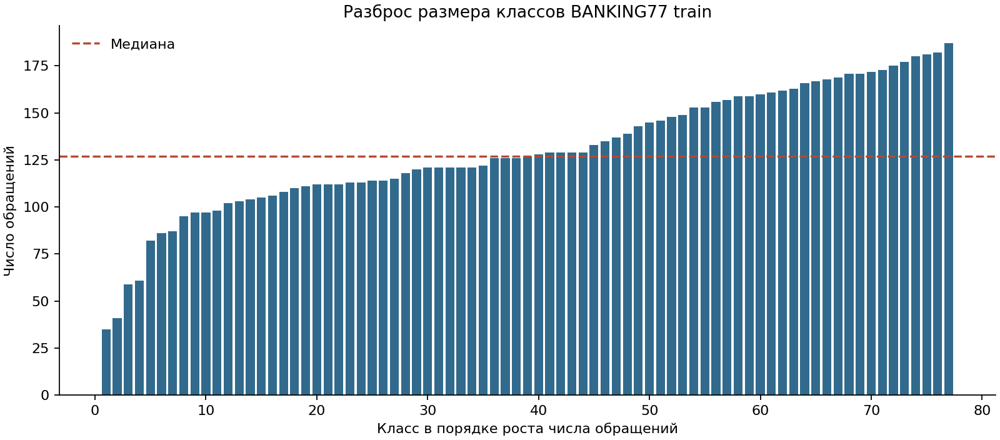
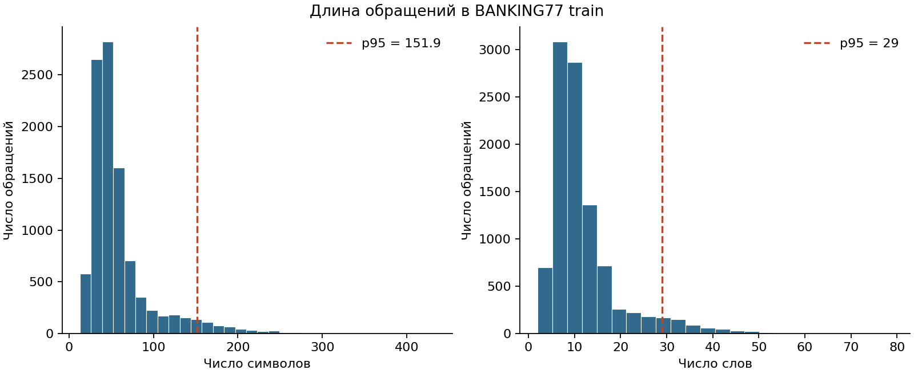
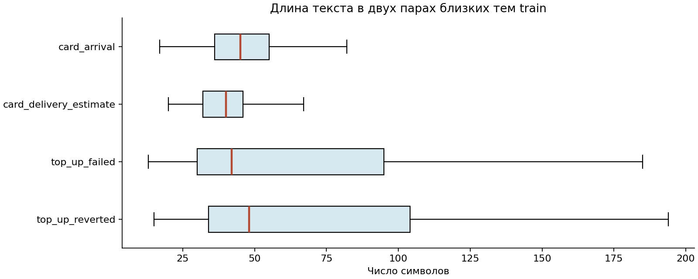

# ДЗ №2. EDA для Support Intent Router

Задача — по тексту англоязычного обращения определить одну из 77 банковских тем.
EDA проверяет пригодность BANKING77 для обучения и оценки классификатора.
Результаты использованы в [разделе «Этапы решения задачи»](../docs/ml_system_design_doc.md#stages).

## Источник и воспроизведение

Авторы — Iñigo Casanueva, Tadas Temčinas, Daniela Gerz, Matthew Henderson и Ivan Vulić.
Лицензия CC BY 4.0. Использован оригинальный снимок PolyAI с ревизией
`57ec275d8078af65b7731c2a98be812d844a6d6b`. [Файлы датасета](https://github.com/PolyAI-LDN/task-specific-datasets/tree/57ec275d8078af65b7731c2a98be812d844a6d6b/banking_data) · [Карточка BANKING77](https://huggingface.co/datasets/PolyAI/banking77) · [Статья авторов](https://arxiv.org/abs/2003.04807).

Из корня репозитория под Python 3.13 и `uv`:

```bash
banking77_source=https://raw.githubusercontent.com/PolyAI-LDN/task-specific-datasets/57ec275d8078af65b7731c2a98be812d844a6d6b/banking_data
mkdir -p data/raw/banking77
for banking77_file in categories.json train.csv test.csv; do
  curl -fsSL "${banking77_source}/${banking77_file}" -o "data/raw/banking77/${banking77_file}" || break
done
uv run --no-project --python 3.13 --with-requirements hw_2/requirements.txt python hw_2/eda.py
```

Скрипт проверяет SHA-256, схему CSV и справочник тем. Он строит графики и сохраняет
[агрегаты EDA](summary.json) и [манифест разбиения](split_manifest.csv).
`sample_id` — split и номер CSV-записи начиная с 1, заголовок пропускается,
многострочный текст считается одной записью. `text_group` — ID первой записи группы.
Исходные CSV хранятся локально в `data/raw/`; манифест и агрегаты не содержат текстов.

## Объём, темы и длина текста

| Показатель | Результат |
| --- | ---: |
| Исходный train | 10 003 |
| Официальный test | 3 080 |
| Тем в train | 77 |
| Пустых текстов или неизвестных меток в train | 0 |
| Размер класса в train, min / p50 / max | 35 / 127 / 187 |
| Длина в символах, min / p50 / p95 / max | 13 / 47 / 151,9 / 433 |
| Длина в словах, min / p50 / p95 / max | 2 / 10 / 29 / 79 |

Символы считаются после обрезки крайних пробелов, слова разделяются пробельными
символами. Перцентили вычислены линейной интерполяцией. Метки test на этапе EDA
оставлены закрытыми, для него проверены размер CSV, наличие пустых текстов и
совпадения с train.



Минимум у `contactless_not_working` (35), затем `virtual_card_not_working` (41).
Максимум у `card_payment_fee_charged` (187), в 5,34 раза больше минимума.
Accuracy будет сильнее зависеть от массовых тем. Для выбора классификатора
используем Macro-F1, в отчёте добавляем recall каждой темы и объём среза.



Медиана — 10 слов. У короткого текста мало контекста, поэтому сохраняем отрицания
и проверяем пользу униграмм, биграмм и символьных n-грамм. Длиннее 2 000 символов
примеров нет. Проверка лимита API потребует отдельных тестовых запросов.



Распределения длины перекрываются. В паре `card_arrival` / `card_delivery_estimate`
медианы 45 и 40 символов. В паре `top_up_failed` / `top_up_reverted` — 42 и 48.
При разборе примеров в первой паре важен контекст уже отправленной карты и ожидания
доставки. Во второй — прошла ли операция перед отменой. Короткие запросы могут
опускать этот контекст. По этим парам проверим матрицу ошибок и случаи, где для
выбора темы нужна ручная проверка.

## Дубликаты и качество разметки

| Проверка | Результат |
| --- | ---: |
| Точные повторы исходного текста в train | 0 |
| Группы повторов после NFKC, casefold и свёртки пробелов | 4 |
| Убрано повторных записей с одинаковой меткой | 4 |
| Точный нормализованный текст с разными метками | 0 |
| Близкие пары после очистки с одной меткой | 121 |
| Близкие пары после очистки с разными метками | 3 |
| Test-записи с точным нормализованным совпадением в train | 7 из 3 080 |

Близость измерена по cosine similarity ≥ 0,90 на символьном TF-IDF 3–5.
Поиск выполнялся только среди очищенных train-текстов. Это эвристика для похожего
написания. Она может пропустить смысловые парафразы и соединить фразы, в которых
одно слово меняет намерение. Три межклассовые пары в [summary.json](summary.json)
включают, например, `declined_transfer` и `declined_card_payment`. Обе метки
сохраняем до ревью специалистом, а пару объединяем в одну группу для разбиения.

Для официального test сохраним результат на всех 3 080 примерах для сравнения
с benchmark. Также посчитаем метрики на 3 073 записях без точных пересечений.
Близкие совпадения с train проверим после фиксации модели и порога, до расчёта
финальных метрик.

## Разбиение для разработки

После очистки осталось 9 999 записей в 9 879 группах. У 104 групп более одной
записи. Связные компоненты графа близости переданы в `StratifiedGroupKFold`
с 5 фолдами и seed 42. Три фолда составляют fit, один selection и один policy.

| Часть | Записей | Тем | Минимум и максимум записей на тему | Назначение |
| --- | ---: | ---: | ---: | --- |
| fit | 6 000 | 77 | 20–112 | Обучение словарей и классификатора |
| selection | 2 003 | 77 | 7–38 | Выбор параметров и анализ ошибок |
| policy | 1 996 | 77 | 7–38 | Выбор порога ручной сортировки |

Ни одна группа не пересекает границы частей. В selection у
`contactless_not_working` всего 7 записей, так что одна ошибка сдвигает recall
на 14,3 п. п. Официальный test используется после фиксации параметров.
Оценка качества и порогов модели запланирована отдельно.

## Конфиденциальность и перенос на банк

В train не найдено совпадений с шаблонами email, телефона, номера карты и IBAN.
Регулярные выражения ограничены перечисленными форматами, имена и адреса ими
не проверялись. В корпусе также нет дат, ID клиентов, фактических очередей
и времени сортировки. Случайное групповое разбиение оценивает перенос внутри
корпуса. Для оценки качества на рабочем потоке нужна свежая обезличенная
разметка, а для измерения сокращения времени сортировки — пилот с ручным
контролем. [План сбора и оценки](../docs/ml_system_design_doc.md#pilot).
